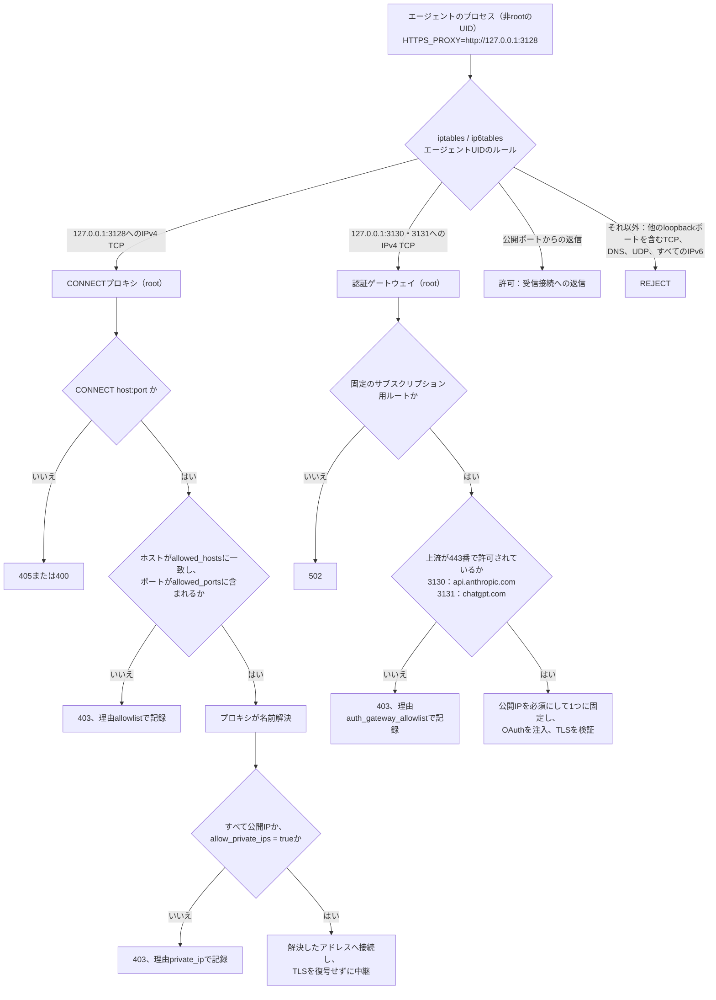
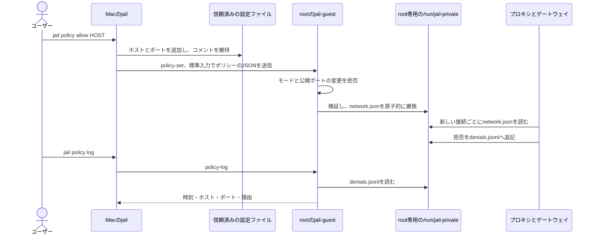

# jail

Claude Code・Codex CLIを、プロジェクトごとの[Apple container](https://github.com/apple/container)で実行するターミナルツール。

[English](README.md) · 日本語

> **Toyプロジェクト／実験的なプロトタイプです。** 個人の実験・学習用で、本番利用を想定していません。第三者によるセキュリティ監査は受けておらず、本番環境のセキュリティ境界として信頼しないでください。破棄できるプロジェクト・アカウントで試し、機密データや本番用の認証情報は避けてください。動作やCLIの互換性は予告なく変わる場合があります。

Apple・Anthropic・OpenAIによる公式提供・推奨ではない、独立したコミュニティプロジェクトです。

```sh
cd /path/to/your/project
jail claude
jail codex
```

`jail`はRust製のCLIです。プロジェクトごとに再利用できるLinuxコンテナを管理し、CLIの引数と作業ディレクトリを引き継ぎます。コンテナの状態もターミナルで確認できます。

> 既定では共有プロジェクトへの書き込みと、制限のない外向き通信を許可します。機密性の高いコードを扱う場合やホストの認証情報を取り込む場合は、先に設定を確認してください。

## 特徴

- **プロジェクト単位の環境** — コンテナを再利用し、専用の永続ホームvolumeを保持。
- **ログイン情報を隠して再利用** — サブスクリプションOAuthはroot専用ゲートウェイに保持し、エージェントにはダミーだけを渡す。APIキーやホスト設定のコピーは不要。
- **機密パスの書き込み保護** — Gitの設定・hooksやエージェント設定を保護し、通常のソースは編集可能。
- **調整可能な通信ポリシー** — 拒否された接続先を確認し、再起動なしで許可を追加。
- **開発サーバーに接続** — MacのIPv4 loopbackへTCPポートを転送し、競合時は別の空きポートを割り当て。
- **設定可能な境界** — 読み取り専用マウント、パスマスク、通信制限、リソース上限、CLI本来のツール制限。

## 目次

- [動作要件](#動作要件)
- [インストール](#インストール)
- [クイックスタート](#クイックスタート)
- [使い方](#使い方)
- [開発サーバー](#開発サーバー)
- [設定](#設定)
- [認証](#認証)
- [セキュリティと制限事項](#セキュリティと制限事項)
- [トラブルシューティング](#トラブルシューティング)
- [開発とコントリビューション](#開発とコントリビューション)
- [ライセンス](#ライセンス)

## 動作要件

- Apple Silicon搭載Mac、macOS 26以降。
- Apple `container` 1.5系。
- ソースからのビルドにはRust 1.85以降とCargo。
- 初回イメージ構築とオンラインのAIリクエストにはインターネット接続。

統合テストにはPython 3も必要です。macOS 27・Apple `container` 1.5.0で実機検証しています。

## インストール

Apple `container`を導入し、このソースをチェックアウトしたディレクトリのルートから`jail`をインストールします。

```sh
brew install container
cargo install --path . --bin jail --locked
```

Cargoの実行ファイルディレクトリ（通常は`~/.cargo/bin`）を`PATH`に含めてください。

起動時に必要に応じてcontainerサービスを開始します。初回は、設定したバージョンのClaude Code・Codexと、Git・Node.js・curl・ripgrepを含むLinuxイメージを構築します。以降はイメージを再利用します。

## クイックスタート

設定ファイルがまだない場合は作成します。

```sh
jail config init
```

`~/.config/jail/config.toml`を確認し、プロジェクト内からエージェントを起動します。

```sh
cd /path/to/your/project
jail claude
jail claude --resume
jail codex
jail codex exec "テストを実行して"
```

**jailのオプションはツール名の前**に指定してください。`claude`・`codex`以降の引数は、設定したポリシーに従ってそのCLIへ渡します。

```sh
jail --auto-stop claude
jail --config /path/to/trusted-config.toml codex
jail --dry-run claude --resume
```

`--dry-run`は起動計画だけを表示します。containerサービスへの接続、認証情報の取り込み、ポートの予約は行いません。新規コンテナ名の表示はプレビューです。

## 使い方

### コマンド

| コマンド | 用途 |
| --- | --- |
| `jail claude [args…]` / `jail codex [args…]` | プロジェクトのコンテナ内でCLIを起動 |
| `jail --ephemeral claude` | マウントなしの使い捨てコンテナでCLIを起動し、終了時に削除 |
| `jail stop [--all]` | 使用中のjailセッションがなければ停止 |
| `jail stop --force` | 使用中のセッションがあっても現在のコンテナを明示的に停止 |
| `jail auth claude` / `jail auth codex` | 対象ツールのホストログインを明示的に再取り込み |
| `jail policy show` / `jail policy log [--json]` | 設定済みポリシー／プロキシの通信拒否を確認 |
| `jail policy allow HOST [--port 443]` / `jail policy reload` | 許可リストを編集／起動中に反映 |
| `jail config show` | 解決済みの設定を表示 |
| `jail recreate` | 現在のコンテナを削除し、次回起動で新規作成 |
| `jail cleanup` | jailのホームvolume・イメージと、それを使うコンテナを一覧表示 |
| `jail cleanup volume NAME…` / `jail cleanup image TAG…` | 指定したホームvolume・イメージを、使うコンテナがなければ削除 |
| `jail cleanup --all-delete` | jailのコンテナ・ホームvolume・イメージをすべて削除 |

詳細なオプションは`jail --help`・`jail <command> --help`で確認できます。

### コンテナのライフサイクル

既定ではコンテナを再利用します。`--auto-stop`はCLI終了時にコンテナを停止しますが、別のjailセッションが使用中なら停止しません。コンテナとホームvolumeは次回起動のために残ります。

名前にはプロジェクトのディレクトリ名と、ローカルの作成日時を使います。

```text
jail-my-app-20261001-153000-123456
```

末尾はマイクロ秒です。Git内ではリポジトリのルート名を使います。ASCII英数字以外は`-`に置換し、名前が残らなければ`project`にします。再利用・再起動では名前は変わりません。`recreate`後の起動で新しい名前になります。旧形式のコンテナも自動で改名・削除しません。

ホームvolumeとライフサイクルのロックは、表示名とは独立したプロジェクトパス由来の固定キーで識別します。

リソース・ポリシー・ポート・イメージ・ランタイムの変更で作り直しが必要な場合は、明示的な操作を要求します。

```sh
# 使用中のセッションを閉じ、対象プロジェクト内で実行
jail recreate
jail claude  # または jail codex
```

> `recreate`はコンテナのルートファイルシステムを削除します。永続ホームや共有マウントの外に追加したファイル・パッケージは失われます。ホームvolume・CLIの設定／履歴・ホストファイルは保持し、次の認証付き起動でホストログインを再取り込みします。

ホームvolumeとイメージは自動では削除しません。`jail cleanup`は、jailのホームvolumeとイメージを一覧表示します。各項目には、分かる範囲でプロジェクトのパス、作成日、使用中のコンテナを示します。削除するのは、指定した名前か、`--all-delete`を付けた場合のすべてです。

```sh
jail cleanup
jail cleanup volume jail-0123456789abcdef-home
jail cleanup image jail-runtime:0123456789abcdef0123
jail cleanup --all-delete
```

`--all-delete`は確認を求めません。まず、jailが記録を持つコンテナをすべて停止・削除します。次に、jailのホームvolumeとイメージを名前で1件ずつ削除します。jailのセッションが1つでも使用中なら、何も削除せずに終了します。jailが記録を持たないコンテナと、jailの形式ではないvolume・イメージには触れません。そのようなコンテナがjailのvolume・イメージを使っている場合は、エラーで削除を止めます。

受け付ける名前は、jail自身の形式（`jail-<16桁の16進数>-home`・`jail-runtime:<20桁の16進数>`）だけです。いずれかのコンテナが使っているvolume・イメージは削除しません。プロジェクトのホームvolumeを削除するには、先にそのセッションを閉じ、そのプロジェクトで`jail recreate`を実行してください。ホームvolumeを削除すると、そのプロジェクトのCLI設定と履歴は元に戻せません。次回起動では空のvolumeを作成します。削除したイメージは、設定が再び必要とした時点で再ビルドします。新しく作るホームvolumeにはプロジェクトのパスをラベルとして付けるため、jailの状態ファイルを削除した後もパスを表示できます。

### 使い捨てセッション

`--ephemeral`は、ホストのディレクトリを一切マウントしない新規コンテナで起動します。プロジェクト・`workspace.mounts`・ホームvolumeのいずれも共有しません。エージェントはコンテナ内の`/home/jail`で起動し、CLIの設定・履歴を含めて書き込んだ内容はセッション終了時にコンテナごと削除します。ホストログインは通常どおり取り込み、通信ポリシー・リソース・ポート転送は設定に従います。どのディレクトリからでも実行できます。

```sh
jail --ephemeral claude
```

jailが強制終了されてコンテナを削除できなかった場合は、`jail cleanup --all-delete`で削除できます。

## 開発サーバー

既定ではコンテナのTCPポート**3000・5173・8000・8080**をMacの`127.0.0.1`へ転送します。ポート転送だけではサーバーは起動しません。

サーバーはコンテナ内の`127.0.0.1`だけでなく、`0.0.0.0`で待ち受けさせてください。たとえばエージェントに次のコマンドで起動させます。

```sh
node -e 'require("http").createServer((req, res) => res.end("hello from jail\n")).listen(8080, "0.0.0.0")'
```

接続する前に、jailの起動時の出力で割り当てられたホスト側ポートを確認します。

```sh
# 起動時に「jail: http://127.0.0.1:8080 -> container:8080 (TCP)」と表示された場合
curl --noproxy '*' http://127.0.0.1:8080
```

作成時に同じホストポートが使用中なら、別の空きポートを自動割り当てします。転送先は起動時に表示します。表示するHTTP URLは開発サーバー向けの例であり、転送自体はTCPです。

```toml
[network]
published_ports = [3000, 5173, 8000, 8080] # [] で転送無効
auto_port = true                        # false: 競合時はエラー
```

転送先は作成時に固定します。停止中のコンテナを再起動するときに保存済みのホストポートが使用中なら、黙って変更せずエラーにします。ポートを空けるか、`recreate`で再割り当てしてください。ポート設定の変更も作り直しが必要です。

`network.mode = "none"`では転送を無効にします。`allowlist`では指定サービスへの受信接続の返信を許可し、外向きの直接接続は禁止したままです。UDPと、待ち受け中の全ポートの自動検出には対応していません。

## 設定

設定は信頼できる入力として扱います。既定は`~/.config/jail/config.toml`です。`--config`、`JAIL_CONFIG`、既定ファイルの順に優先します。プロジェクト内の設定は**自動で読み込みません**。未知のキーや不正な値は拒否します。

全項目と初期値は[config.example.toml](config.example.toml)を参照してください。相対指定のマウント元は設定ファイルのディレクトリから解決し、追加マウント先は`/extra/`配下に限定します。

たとえばホスト共有を読み取り専用にし、機密パスを隠し、外向きの接続先を限定する場合：

```toml
[resources]
cpus = 2
memory = "2G"

[workspace]
read_only = true
hidden = [".env", "secrets"]

[network]
mode = "allowlist"
allowed_hosts = ["api.anthropic.com", "claude.ai", "platform.claude.com",
                 "chatgpt.com", "auth.openai.com", "api.openai.com"]
allowed_ports = [443]
allow_private_ips = false
published_ports = []

[tools]
shell = false
edit = false
web_search = false
mcp = false
hooks = false
```

ホスト一覧は出発点の例であり、すべてのアカウントや機能に必要な接続先を網羅しません。完全一致または`*.example.com`を使えます。ワイルドカードはサブドメインだけを許可し、`example.com`自体は含みません。

許可リストモードはHTTPSのCONNECTプロキシとエージェントUIDのファイアウォールを使い、直接TCP・直接DNS・直接IPv6を遮断します。通常のHTTPプロキシ要求、UDP、外向きの直接接続を必要とするツールには対応しません。上流のプライベートIP・loopback・link-localは既定で拒否します。許可した接続先へのデータ送信は可能で、リクエストの内容までは検査・制限しません。

さらに`tools.claude_deny`（例：`["Bash(git push *)"]`）や`tools.codex_disabled_features`（例：`["multi_agent"]`）でCLI本来の制限を追加できます。設定したCLIバージョンが対応するルール・機能名を指定してください。MCPとhooksは既定で無効です。

### 機密パスの書き込み保護

既定で`.git/config`、`.git/hooks`、`.mcp.json`、プロジェクトの`.claude/`・`.codex/`、`.bashrc`・`.zshrc`・`.ripgreprc`を読み取り専用マウントで保護します。通常のソースは編集可能です。親ディレクトリもマウント境界にし、名前変更による保護対象の置換を防ぎます。保護パス内のsymlink・hard-linkと、ワークスペースに重なる書き込み可能な追加マウントは拒否します。

存在しない対象には**ホスト側から見えるプレースホルダー**（空ファイル／ディレクトリ、`.mcp.json`には`{}`）を作成します。既存内容は上書きせず、自動削除もしません。worktreeでは外部メタデータの代わりに`.git`ポインタを保護します。すべての実行設定を網羅するものではないため、プロジェクト固有の対象は追加してください。

```toml
[workspace]
protect_sensitive = true
deny_write = ["package.json", "scripts/trusted/"]
```

存在しないディレクトリには末尾`/`を付けます。`protect_sensitive = false`で既定の対象を無効化できますが、明示した`deny_write`は有効です。マウント変更には`jail recreate`が必要です。ホストからの編集は可能で、隔離の対象外です。

### 書き込み可能なパスの指定

エージェントに特定のパスだけを書き込ませるには、`allow_write`に列挙します。ワークスペースのそれ以外は読み取り専用になります。

```toml
[workspace]
allow_write = ["src/", "tests/", "CHANGELOG.md"]
```

パスはプロジェクトからの相対パスです。存在しないパスは、末尾に`/`があればディレクトリとして作成し、なければエラーにします。許可したパス内の保護対象（上記の既定の対象と`deny_write`）は読み取り専用のままで、`hidden`に含まれるエントリは無視します。許可したパスはそれぞれ独立したマウントになるため、名前変更・移動はできず、ワークスペースの他の場所との間でファイルを移動することもできません。ファイルを置き換えて保存するツールは単一ファイルの指定では失敗するため、ディレクトリでの指定を推奨します。Gitでコミットさせるには`.git/`も必要です。`read_only = true`・`tools.edit = false`とは併用できず、ワークスペースに重なる書き込み可能な追加マウントは拒否します。変更には`jail recreate`が必要です。

### 許可リストの制御の仕組み

許可リストは、VM内の2つの層で強制します。ファイアウォールは、エージェントのプロセスが接続できるローカルの接続先を決めます。その先にあるrootのサービスが、接続できる上流のホストを決めます。ファイアウォールのルールはエージェントのUIDだけに適用します。そのため、rootのプロキシとゲートウェイは外部へ接続できますが、エージェントのプロセスはそれらを迂回できません。



- プロキシは、CONNECT行のホスト名とポートだけで判定します。名前解決はプロキシ自身が行い、解決したアドレスへ接続します。TLSはそのまま中継するため、パス・ヘッダー・本文は検査しません。
- ゲートウェイは`allow_private_ips`の設定にかかわらず、上流に公開IPを必須とします。
- `open`ではファイアウォールを設定しません。`none`では、プロキシとゲートウェイのポートを含め、エージェントの通信をすべて拒否します。

許可リストの変更は、再起動せずに実行中のコンテナへ反映します。



起動のたびに、信頼済みの設定ファイルの通信ポリシーもコンテナへ送ります。そのため、設定ファイルを手動で編集した変更は、次回の起動時か、`jail policy reload`の実行時に反映します。

### 許可リストの調整

`network.mode = "allowlist"`で通信拒否を確認し、必要な接続先を明示的に許可できます。

```sh
jail policy log
jail policy allow registry.npmjs.org
jail policy log --json
# allowed_hosts / allowed_ports / allow_private_ips を手動編集した後:
jail policy reload
```

`allow`は設定のコメントを維持し、起動中のコンテナへ再起動せず反映します。ホストとポートの一覧は独立しており、ポート追加は許可済みの全ホストに適用します。許可の削除は設定を編集してreloadしてください。通信モード・公開ポートの変更は再作成が必要です。変更は**新しい接続**に適用し、既存のCONNECT接続は切断しません。ログからの自動許可はしません。

root専用のログには時刻・ホスト名・ポート・拒否理由だけを残し、URL・ヘッダー・本文は保存しません。最大約2 MiBで、停止時に消えます。記録対象はプロキシ／認証ゲートウェイのポリシー拒否であり、直接通信のファイアウォール拒否・DNS失敗・操作履歴ではありません。`policy show`は設定ファイルの内容で、反映済みとは限りません。

## 認証

**サブスクリプションのログイン専用で、APIキーは使いません。** ホストのファイル／macOS KeychainにあるClaude・ChatGPTのログインを再利用します。実トークンは標準入力でゲストのroot専用認証ゲートウェイへ送り、tmpfsの`/run/jail-private`（`0700`、ファイルは`0600`）だけに保持します。エージェントにはダミーOAuth情報を渡し、実際のaccess・refresh・ID tokenは渡しません。既存のホスト認証への書き戻しはしません。

- ホストの設定・skills・MCP・会話履歴はコピーしません。
- 設定・履歴・ダミー認証はプロジェクト専用の永続ホームに保持します。実トークンは永続化しません。
- ホスト認証がない場合も対話セッションを起動できます。Macでログインすると、セッションへ反映されます。Keychain拒否・非対応形式などで取り込みに失敗した場合はエラーになります。コンテナのCLIを直接使うログイン／ログアウトと、APIキーの環境変数転送は拒否します。
- 認証付きセッションの実行中は、ホスト認証が変わったかを15秒ごとに確認します。確認にはファイルのメタデータかKeychainの属性を使い、パスワードは読みません。Macの公式CLIがログインを更新または置換すると、jailはそれを1回だけ読み、実行中のゲートウェイへ送ります。ゲートウェイは、受け取ったアクセストークンの期限が現在より後の場合だけ採用します。そのため、別のセッションが読んだ古い認証が、新しい認証を上書きすることはありません。確認はプロジェクトとツールごとに1セッションだけが行います。失敗はセッション終了後に表示します。
- jail自身はOAuthトークンを更新せず、ホストの認証情報にも書き込みません。ホストのCLIが更新しなければ、ゲートウェイも更新されません。Keychainのアクセスを1回だけ許可した場合、項目が変わるとmacOSが再度確認することがあります。拒否した場合は、次に項目が変わったときに再試行します。
- 強制的に再取り込みする場合は、セッションを閉じて`jail auth claude`・`jail auth codex`を実行します。
- `auth.import_host = false`で自動取り込みとホスト認証の同期を無効にできます。明示的な`jail auth`は利用可能です。実トークンは停止時に消え、次の認証付き起動で再取り込みします。

ゲートウェイは固定のHTTPSサブスクリプション接続先（`api.anthropic.com`・`chatgpt.com`）にだけOAuthを注入します。TLS検証・公開IPへの接続固定・リダイレクト拒否を行い、`none`を含む通信ポリシーに従います。Claudeはサブスクリプションを維持するbase URL設定、CodexはOAuth認証付きのカスタムproviderでHTTP/SSEを使います。WebSocketは使わず、Codexのprovider別resume一覧は以前と異なる場合があります。対応するendpointは固定CLIバージョン向けに限定し、cloud・アカウント管理・任意ルートには対応しません。ゲートウェイ自身はトークンを更新しません。期限が切れてホスト認証も更新されていない場合は、Macで`claude auth login`または`codex login`を実行し、失敗したリクエストを再実行してください。

**ログインはMacでだけ行います。** jail自身はログインを実行せず、セッションからログインするコマンドもありません。Macで`claude auth login`または`codex login`を実行してください。`auth.import_host = true`であれば、約15秒以内に実行中のセッションへ反映されます。対話端末で行頭から`/login`を手入力した場合（`/log`からのTab補完を含む）は、jailが受け取ります。エージェントのCLIには渡さず、Macで実行するコマンドを表示します。矢印キーによるメニュー選択や貼り付けたコマンドは判定しないため、エージェントのCLIに届きます。その方法でコンテナ内のログインが始まっても、完了させないでください。コンテナ内のCLIが、エージェントから読めるホームvolumeに実トークンを保存する可能性があります。

起動時に既知の旧ゲスト認証ファイルをダミーへ置換します。別の場所にコピーされた情報は探索・削除せず、一度露出したトークンを後から秘密にはできません。ゲートウェイは**VM内**にあり、ホスト側の外部認証サービスではありません。rootの監督プロセスとゲートウェイは信頼対象です。エージェントはトークンを読めなくても、許可された推論を利用できます。

参考: [Codex認証](https://learn.chatgpt.com/docs/auth)、[Codex provider設定](https://learn.chatgpt.com/docs/config-file/config-reference)、[Claudeのサブスクリプションを維持するgateway](https://code.claude.com/docs/en/llm-gateway)。

カスタム`CLAUDE_CONFIG_DIR`のKeychain名は推測しません。この指定時はファイル形式の認証情報だけを扱います。アカウントや組織のポリシーによっては再認証が必要です。

## セキュリティと制限事項

jailはLinux実行環境を分離しますが、**信頼できないエージェントやプロジェクトを既定で安全にするものではありません**。共有ファイルと許可された推論は利用できますが、実際のホストログイントークンは非rootエージェントから隠します。

| 境界 | 動作 |
| --- | --- |
| 作業範囲 | Git内ではリポジトリ全体、Git外では起動ディレクトリをホストと同じパスで共有。現在のサブディレクトリを維持 |
| ホストへのアクセス | ホーム全体・SSH agent・container管理ソケットは共有せず、ホームやその親からの起動を拒否 |
| 書き込み | `workspace.read_only`または`tools.edit = false`で全ホスト共有を読み取り専用にする。ゲストホームと`/tmp`は書き込み可能 |
| 機密設定 | 既定の読み取り専用bind mountと親のマウント境界、追加の`workspace.deny_write` |
| 認証情報 | root専用tmpfsゲートウェイが固定接続先へトークンを注入。エージェントにはダミーのみ |
| パスを隠す | Appleの実験的なパスマスクを使用。失敗時に制限を外して再試行しない |
| 通信 | `open`は外向き通信を許可、`none`はエージェントのIPv4/IPv6通信を遮断、`allowlist`はプロキシとファイアウォールで接続先を限定 |
| リソース | コンテナのCPU割り当てとメモリを制限 |
| エージェント実行 | 非root、capabilityを除去し、`no_new_privs`を設定 |
| CLIポリシー | Claudeのmanaged settings・ツール拒否、Codexの設定・managed requirementsを適用。制限がある場合は上書き引数を拒否 |

CLI本来のツール制限は多層防御であり、**任意プログラムへのシステムコール単位の制限ではありません**。適用は設定したCLIバージョンに依存します。ポリシーの設定が失敗した場合はCLIを起動しません。

信頼された初期化処理だけがLinuxのbind mount設定に`SYS_ADMIN`を使い、設定後に監督プロセスから除去します。エージェントのcapabilityはすべて除去し、保護パスをremountできません。

ホストの転送リスナーはIPv4 loopback限定です。ただしコンテナ自身のIPにはMacや同じcontainerネットワークの別コンテナから到達できます。ポート転送はコンテナ間の受信隔離ではありません。機密性の高いサービスはアプリケーション側でも保護してください。

現在のその他の制限事項：

- ゲストはLinuxです。ホストのHomebrewツールやmacOS専用コマンドは使えません。
- 共有範囲外にメタデータがあるGit worktreeは自動対応しません。
- システムパッケージ用のカスタムイメージ、操作履歴は[ロードマップ](TODO.md)に記載しています。
- Codexは同梱のbubblewrapサンドボックスを使います。注入する設定により、共有バックグラウンドサーバーではなく組み込みモードになり、対応する警告が出る場合があります。

## トラブルシューティング

### 転送先への接続がリセット・拒否される

ポート公開は、アプリケーションが待ち受けていることを意味しません。次を確認してください。

1. コンテナが起動しており、サーバーが正常に起動しているか。
2. サーバーが`0.0.0.0`と、想定したコンテナ側ポートで待ち受けているか。
3. コンテナ側とは異なる場合がある、表示された**ホスト側ポート**へ接続しているか。
4. IPv6に解決された`localhost`ではなく`127.0.0.1`へ接続し、確認時はローカルプロキシを回避しているか。
5. ネットワークモードが`none`ではなく、ポート設定を変えた場合はコンテナを作り直しているか。

リセットだけでは原因を特定できません。設定を変更する前にサーバーの出力を確認してください。

### 設定・イメージ変更のエラーが出る

使用中のセッションを閉じ、対象プロジェクト内で`jail recreate`を実行します。先に[削除される範囲](#コンテナのライフサイクル)を確認してください。既存コンテナは黙って置き換えません。

### 認証情報がない・失効している

Macで`claude auth login`または`codex login`を実行してください。新しいログインや、ホストのCLIが更新したログインは、約15秒以内に実行中のセッションへ反映されます。その後、失敗したリクエストを再実行してください。`auth.import_host = false`の場合は、セッションを閉じて`jail auth claude`・`jail auth codex`を実行します。APIキーへのフォールバックはしません。

### 保存済みのホストポートが使用中になった

ポートを空けるか、停止中のコンテナを作り直して新しいポートを割り当てます。`network.auto_port`が競合を解決するのは新規作成時だけで、再起動時ではありません。

## 開発とコントリビューション

バグ報告、ドキュメントの改善、プルリクエストを歓迎します。macOS・container・jail・エージェントCLIのバージョン、最小限の再現手順、機密情報を除いた設定を添えてください。認証情報・トークン・未加工のコマンド引数は添付しないでください。

リポジトリのルートから実行します。

```sh
cargo fmt --all --check
cargo test --locked --all-targets
cargo clippy --locked --all-targets -- -D warnings
cargo build --locked --release --bin jail
./target/release/jail --dry-run claude --resume
```

統合テストはPython製のApple container代替と一時的なloopbackリスナーを使います。実際のcontainerサービスには接続せず、ホスト認証も取り込みません。

releaseバイナリをビルドした後、必要に応じて実コンテナで検証できます。

```sh
./scripts/smoke-test.sh
./scripts/auth-smoke-test.sh
# localhostの模擬サーバーだけでCLIのHTTP/SSEを確認（macOS sandbox-exec必須）:
python3 scripts/protocol-smoke-test.py
```

コンテナのテストは専用の一時コンテナとホームvolumeを作成・削除し、既存プロジェクトには触れません。smoke testはホスト認証なしで保護パスの置換拒否・通信拒否ログ／live reload・各制限・転送・Codexサンドボックスを確認します。auth testはホストログインをroot専用tmpfsへ取り込み、認証認識・トークン非公開・モデル一覧の読み取りを確認します。推論は実行しません。protocol testはダミー認証とlocalhostの模擬SSEサーバーだけを使い、macOS sandboxで外向き通信を遮断します。

ホスト側のエントリーポイントは[src/host/main.rs](src/host/main.rs)、ランタイム管理は[src/host/runtime.rs](src/host/runtime.rs)です。Appleの`container`コマンドの呼び出しは、すべて[src/host/apple_container](src/host/apple_container)を通します。Linux側のスーパーバイザーは[src/container/main.rs](src/container/main.rs)です。両側が使うコードは[src/shared](src/shared)にあります。

`JAIL_HOME`でホストの管理状態・ビルド用ディレクトリ（通常は`~/.local/share/jail`）を変更できます。`JAIL_CONTAINER_BIN`はテスト用のbackend実行ファイルを指定します。変更した動作のテストを追加し、英語・日本語のREADMEを合わせて更新してください。予定する作業は[TODO.md](TODO.md)で管理しています。

## ライセンス

MITライセンスの対象はjail自身のソースコードです。コンテナの構築時にダウンロードするCLIなど、第三者のツール・依存ライブラリにはそれぞれのライセンス・利用条件が適用されます。このリポジトリにはそれらの実行バイナリを含めていません。

[MIT](LICENSE) © 2026 jail contributors.
