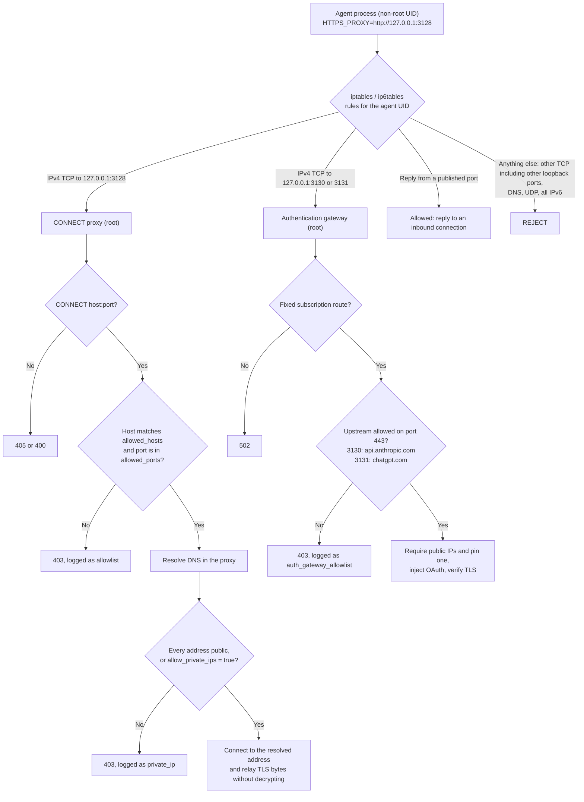
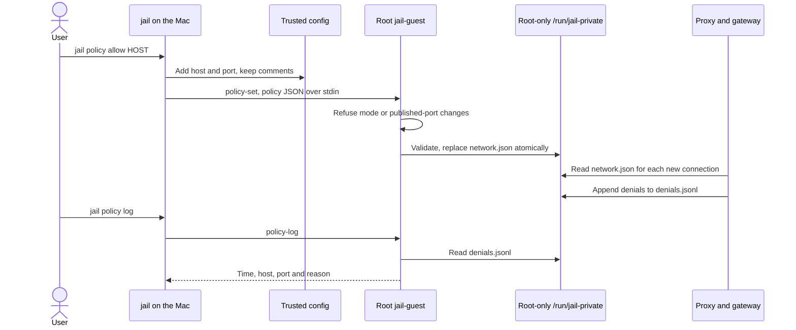

# jail

Run Claude Code and Codex CLI in project-scoped [Apple containers](https://github.com/apple/container), from your terminal.

English · [日本語](README.ja.md)

> **Toy project / experimental prototype.** Built for personal experimentation and learning, not production use. It has not undergone an independent security audit and must not be relied on as a production security boundary. Use disposable projects and accounts; avoid sensitive data or production credentials. Behavior and CLI compatibility may change without notice.

This is an independent community project, not affiliated with or endorsed by Apple, Anthropic, or OpenAI.

```sh
cd /path/to/your/project
jail claude
jail codex
```

`jail` is a Rust CLI that manages a reusable Linux container for each project. It forwards your CLI arguments, keeps your working directory, and lets you inspect the environment without leaving the terminal.

> Default settings allow writes to the shared project and unrestricted outbound networking. Review your configuration before running an agent on sensitive code or importing host credentials.

## Features

- **Project-scoped environments** — reusable containers with separate persistent home volumes.
- **Private host login reuse** — subscription OAuth stays in a root-only gateway; agents see placeholders. No API keys or copied host settings.
- **Sensitive write protection** — protect Git configuration/hooks and agent configuration while keeping source files editable.
- **Adjustable network policy** — inspect denied destinations and approve allowlist changes without a restart.
- **Local development** — TCP forwarding to your Mac's IPv4 loopback interface, with automatic host-port allocation on conflicts.
- **Configurable boundaries** — read-only mounts, hidden paths, network restrictions, resource limits, and native CLI tool policies.

## Contents

- [Requirements](#requirements)
- [Installation](#installation)
- [Quick start](#quick-start)
- [Usage](#usage)
- [Development servers](#development-servers)
- [Configuration](#configuration)
- [Authentication](#authentication)
- [Security and limitations](#security-and-limitations)
- [Troubleshooting](#troubleshooting)
- [Development and contributing](#development-and-contributing)
- [License](#license)

## Requirements

- An Apple silicon Mac running macOS 26 or later.
- Apple `container` 1.5.x.
- Rust 1.85 or later and Cargo to build `jail` from source.
- Internet access for the initial container-image build and online AI requests.

Python 3 is also required for the integration tests. macOS 27 with Apple `container` 1.5.0 has been used for real-container verification.

## Installation

Install Apple `container`, then install `jail` from the root of this source checkout:

```sh
brew install container
cargo install --path . --bin jail --locked
```

Ensure Cargo's bin directory, usually `~/.cargo/bin`, is on your `PATH`.

On launch, `jail` starts the container service if necessary. The first launch builds a Linux image containing the configured Claude Code and Codex versions, plus Git, Node.js, curl, and ripgrep. Subsequent launches reuse the image.

## Quick start

Create a config if you do not already have one:

```sh
jail config init
```

Review `~/.config/jail/config.toml`, then launch an agent from your project:

```sh
cd /path/to/your/project
jail claude
jail claude --resume
jail codex
jail codex exec "Run the tests"
```

Put **jail options before the tool name**. Arguments after `claude` or `codex` are passed to that CLI, subject to the configured policy:

```sh
jail --auto-stop claude
jail --config /path/to/trusted-config.toml codex
jail --dry-run claude --resume
```

`--dry-run` prints a launch plan without contacting the container service, importing credentials, or reserving ports. A new container name in the plan is only a preview.

## Usage

### Commands

| Command | Purpose |
| --- | --- |
| `jail claude [args…]` / `jail codex [args…]` | Launch the native CLI inside the project's container |
| `jail stop [--all]` | Stop managed containers that have no active jail sessions |
| `jail stop --force` | Explicitly stop the current container even with active sessions |
| `jail auth claude` / `jail auth codex` | Explicitly re-import the tool's host login |
| `jail policy show` / `jail policy log [--json]` | Inspect configured policy / denied proxy destinations |
| `jail policy allow HOST [--port 443]` / `jail policy reload` | Edit trusted allowlist / apply changes live |
| `jail config show` | Print the resolved configuration |
| `jail recreate` | Remove the current container; the next launch creates a new one |
| `jail cleanup` | List jail home volumes and images, with the containers using them |
| `jail cleanup volume NAME…` / `jail cleanup image TAG…` | Delete the named home volumes / images if no container uses them |
| `jail cleanup --all-delete` | Delete every jail home volume and image that no container uses |

Use `jail --help` or `jail <command> --help` for command-specific options.

### Container lifecycle

Containers are reused by default. `--auto-stop` stops the container after the CLI exits unless another jail session is using it. The container and its home volume remain available for the next launch.

Names use the project directory and local creation time:

```text
jail-my-app-20261001-153000-123456
```

The final component is microseconds. In a Git repository, the directory name comes from the repository root. Non-ASCII-alphanumeric characters are replaced with `-`; an empty result becomes `project`. Names remain unchanged when containers are reused or restarted. A launch after `recreate` generates a new name. Legacy containers are not automatically renamed or deleted.

Home-volume identifiers and lifecycle locks use a stable key derived from the project's path, independent of the visible container name.

When resource, policy, port, image, or runtime changes require replacement, jail asks you to recreate explicitly:

```sh
# Close active sessions first; run from the affected project.
jail recreate
jail claude  # or jail codex
```

> `recreate` deletes the container's root filesystem, including packages and files added outside its persistent home or shared mounts. It preserves the project's home volume, CLI settings/history and host files. Host login is re-imported on the next authenticated launch.

Home volumes and images are never deleted automatically. `jail cleanup` lists jail's home volumes and images, each with its project path where known, creation date and the containers using it. Deletion runs only for the names you pass, or for every unused one with `--all-delete`:

```sh
jail cleanup
jail cleanup volume jail-0123456789abcdef-home
jail cleanup image jail-runtime:0123456789abcdef0123
jail cleanup --all-delete
```

`--all-delete` asks for no confirmation. It deletes jail's home volumes and images one by one by name, skips and reports those in use, and never touches volumes or images in other formats.

Only names in jail's own formats (`jail-<16 hex>-home`, `jail-runtime:<20 hex>`) are accepted. A volume or image used by any container is refused; to free a project's home volume, close its sessions and run `jail recreate` in that project first. Deleting a home volume permanently removes that project's CLI settings and history; the next launch creates an empty one. A deleted image is rebuilt when a configuration needs it again. New home volumes carry their project path as a label, so the path remains visible after jail state is removed.

## Development servers

By default, jail forwards container TCP ports **3000, 5173, 8000, and 8080** to your Mac's `127.0.0.1`. Port forwarding does **not** start a server.

The server must listen on `0.0.0.0`, not only on the container's `127.0.0.1`. For example, an agent can start one with:

```sh
node -e 'require("http").createServer((req, res) => res.end("hello from jail\n")).listen(8080, "0.0.0.0")'
```

Check the assigned host port in jail's launch output before connecting:

```sh
# If launch output shows "jail: http://127.0.0.1:8080 -> container:8080 (TCP)":
curl --noproxy '*' http://127.0.0.1:8080
```

If the same host port is occupied during creation, jail allocates a different available port. Launch output shows the mapping. Displayed HTTP URLs are conveniences for web development; the transport itself is TCP.

```toml
[network]
published_ports = [3000, 5173, 8000, 8080] # [] disables forwarding
auto_port = true                        # false makes conflicts an error
```

Mappings are fixed at creation. If a saved host port is occupied when restarting a stopped container, jail returns an error instead of silently changing it. Free the port or recreate the container to allocate new mappings. Port configuration changes also require recreation.

`network.mode = "none"` disables forwarding. In `allowlist` mode, replies to inbound connections on configured service ports are allowed without permitting direct outbound connections. UDP and automatic detection of all listening ports are not supported.

## Configuration

Configuration is trusted input. The default file is `~/.config/jail/config.toml`; `--config` takes precedence over `JAIL_CONFIG`, which takes precedence over that default. Project config files are **never loaded automatically**. Unknown keys and invalid values are rejected.

See [config.example.toml](config.example.toml) for all settings and defaults. Relative mount sources resolve against the config file's directory; extra mount targets must be under `/extra/`.

For example, to make host mounts read-only, hide sensitive paths, and restrict outbound destinations:

```toml
[resources]
cpus = 2
memory = "2G"

[workspace]
read_only = true
hidden = [".env", "secrets"]

[network]
mode = "allowlist"
allowed_hosts = ["api.anthropic.com", "claude.ai", "platform.claude.com",
                 "chatgpt.com", "auth.openai.com", "api.openai.com"]
allowed_ports = [443]
allow_private_ips = false
published_ports = []

[tools]
shell = false
edit = false
web_search = false
mcp = false
hooks = false
```

The host list is a starting point, not an exhaustive list for every account or feature. Exact hostnames and `*.example.com` are supported; the wildcard matches subdomains, not `example.com` itself.

Allowlist mode uses an HTTPS CONNECT proxy and an agent-UID firewall. It blocks direct TCP, direct DNS, and direct IPv6 traffic. Ordinary HTTP proxy requests, UDP, and tools requiring direct outbound connections are not supported. Private, loopback, and link-local upstream addresses are denied by default. Allowed destinations can still receive data; the allowlist does not inspect or restrict request contents.

Additional native restrictions can be configured with `tools.claude_deny` (for example, `["Bash(git push *)"]`) and `tools.codex_disabled_features` (for example, `["multi_agent"]`). Use rules and feature names supported by the configured CLI versions. MCP and hooks are disabled by default.

### Sensitive write protection

By default, `.git/config`, `.git/hooks`, `.mcp.json`, project `.claude/` and `.codex/`, `.bashrc`, `.zshrc`, and `.ripgreprc` are read-only mount boundaries. Ordinary source files remain writable. Parent mount boundaries prevent renaming a directory to replace a protected path. Symlink/hard-link aliases in protected paths and writable extra mounts overlapping the workspace are rejected.

Missing targets receive **host-visible placeholders** (empty files/directories; `{}` for `.mcp.json`). Existing contents are never overwritten. Placeholders are not automatically removed. A worktree's `.git` pointer is protected instead of inaccessible external metadata. This does not protect every possible executable configuration file; add project-specific paths explicitly:

```toml
[workspace]
protect_sensitive = true
deny_write = ["package.json", "scripts/trusted/"]
```

Use a trailing `/` for missing directories. Set `protect_sensitive = false` to disable defaults; explicit `deny_write` still applies. Mount changes require `jail recreate`. Host-side edits remain possible and are outside the agent isolation boundary.

### How allowlist enforcement works

Two layers inside the VM enforce the allowlist. The firewall decides which local endpoints agent processes can reach. Root-owned services behind those endpoints decide which upstream hosts are reachable. Firewall rules match only the agent's UID, so the root proxy and gateway can reach the network, while agent processes cannot bypass them.



- The proxy decides only from the host name and port in the CONNECT line. It resolves DNS itself and connects to the address it resolved. TLS is relayed unchanged, so paths, headers and bodies are not checked.
- The gateway always requires public upstream addresses, regardless of `allow_private_ips`.
- In `open` mode no firewall is installed. In `none` mode all agent traffic is rejected, including the proxy and gateway ports.

Policy changes reach a running container without restarting it:



Each launch also sends the trusted config's network policy to the container. Manual edits therefore apply on the next launch, or immediately with `jail policy reload`.

### Adjusting an allowlist

In `network.mode = "allowlist"`, inspect denials and approve a destination explicitly:

```sh
jail policy log
jail policy allow registry.npmjs.org
jail policy log --json
# After manually editing allowed_hosts/allowed_ports/allow_private_ips:
jail policy reload
```

`allow` preserves config comments and updates a running container without restarting it. Host and port lists are independent: adding a port permits it for all allowed hosts. Removing a host requires editing the trusted config and reloading. Network mode and published-port changes still require recreation. New policy applies to **new connections**; existing CONNECT tunnels are not terminated. No automatic approvals are made from logs.

The root-only journal contains time, hostname, port and reason—not URLs, headers or bodies. It is bounded to approximately 2 MiB and resets on stop. It records proxy/gateway policy denials, not direct firewall drops, DNS failures, or an operation audit trail. `policy show` shows configured, not necessarily already-applied, policy.

## Authentication

**Subscription login only; no API keys.** jail reuses Claude / ChatGPT host login from files or macOS Keychain. Credentials travel over standard input into a root-only authentication gateway in guest tmpfs (`/run/jail-private`, mode `0700`; files `0600`). The agent receives synthetic OAuth placeholders, never real access/refresh/ID tokens. Existing host credentials are not overwritten.

- Host settings, skills, MCP configuration, and conversation history are not copied.
- Each project has a separate persistent guest home for settings, history and placeholder auth; real credentials do not persist there.
- Interactive sessions can start without host credentials; sign in on the Mac and the session receives the login. Import failures such as denied Keychain access or unsupported formats still report an error. Direct container CLI login/logout and API-key environment forwarding are rejected.
- During an authenticated session, jail checks every 15 seconds whether the host login changed. The check uses file metadata or Keychain attributes and does not read the password. When the official CLI on the Mac refreshes or replaces its login, jail reads it once and sends it to the running gateway. The gateway accepts it only if its access token expires later than the current one, so an older copy read by another session never replaces a newer login. One session per project and tool performs the check. Failures are reported after the session ends.
- jail does not refresh OAuth tokens or write host credentials. If the host CLI does not refresh its login, the gateway is not refreshed either. If Keychain access was allowed only once, macOS may ask again when the item changes; a denied read is retried after the next change.
- To force a re-import, close active sessions and run `jail auth claude` or `jail auth codex`.
- Set `auth.import_host = false` to disable automatic import and host-login sync; explicit `jail auth` is still available. Credentials vanish on stop and are imported again on the next authenticated launch.

The gateway injects OAuth only for fixed HTTPS subscription endpoints (`api.anthropic.com` and `chatgpt.com`), verifies TLS, pins resolved public IPs, and never follows redirects. It obeys network policy, including `none`. Claude uses its subscription-preserving base-URL setting; Codex uses an OAuth-backed custom provider with HTTP/SSE rather than WebSocket transport. Provider-specific Codex resume lists may differ from older sessions. Endpoint compatibility is limited to the pinned CLI versions; cloud, account-management and arbitrary gateway routes are not supported. The gateway does not refresh tokens itself. If login expires and the host login has not been refreshed, run `claude auth login` or `codex login` on the Mac, then retry the failed request.

**Sign in only on the Mac.** jail never runs a login itself and has no command for signing in from a session. Run `claude auth login` or `codex login` on the Mac; with `auth.import_host = true`, running sessions receive the new login within about 15 seconds. In an interactive terminal, a `/login` typed at the start of a line (including Tab completion from `/log`) is answered by jail: it is not passed to the agent CLI, and jail shows the command to run on the Mac. Arrow-key menu selections and pasted commands are not interpreted and reach the agent CLI. Do not complete a login started that way inside the container: the CLI there could store real tokens in the agent-readable home volume.

Known legacy guest auth files are replaced with placeholders on startup. Existing credential copies elsewhere are not discovered or deleted; a previously exposed token cannot be made secret retroactively. The gateway is **inside the VM**, not an external host-side credential service: it and the root supervisor remain trusted, and an agent can use authorized inference without learning the token.

References: [Codex authentication](https://learn.chatgpt.com/docs/auth), [Codex provider configuration](https://learn.chatgpt.com/docs/config-file/config-reference), [Claude subscription-preserving gateways](https://code.claude.com/docs/en/llm-gateway).

Custom `CLAUDE_CONFIG_DIR` Keychain names are not guessed; only file-based credentials are considered for that override. Account and organization policies may require reauthentication.

## Security and limitations

jail isolates a Linux execution environment, but **does not make untrusted agents or projects safe by default**. Shared files and authorized inference remain available within the configured permissions; real host login tokens are hidden from non-root agents.

| Boundary | Behavior |
| --- | --- |
| Workspace | Shares the entire Git root, or the launch directory outside Git, at the same host path; preserves the current subdirectory |
| Host access | Does not share the host home, SSH agent, or container-management socket; rejects launching from the home directory or its ancestors |
| Writes | `workspace.read_only` or `tools.edit = false` makes all shared host mounts read-only; guest home and `/tmp` remain writable |
| Sensitive configuration | Default read-only bind mounts plus parent mount boundaries; custom `workspace.deny_write` |
| Credentials | Root-only tmpfs gateway injects subscription tokens for fixed upstreams; agents get placeholders |
| Hidden paths | Uses Apple's experimental path masking; startup does not retry with the restriction removed |
| Networking | `open` allows outbound traffic; `none` blocks agent IPv4/IPv6 traffic; `allowlist` restricts destinations through the proxy and firewall |
| Resources | Limits the container's CPU allocation and memory |
| Agent execution | Runs agents as non-root with dropped capabilities and `no_new_privs` |
| CLI policy | Applies Claude managed settings/tool denials and Codex configuration/managed requirements; rejects policy-override arguments when restrictions apply |

Native tool policies are defense in depth, **not syscall-level restrictions on arbitrary programs**. Enforcement depends on the configured CLI versions. If policy setup fails, jail does not launch the CLI.

The trusted initializer has `SYS_ADMIN` only to set Linux bind-mount boundaries; the supervisor drops that capability after setup. Agents drop every capability and cannot remount protected paths.

Host port-forwarding listeners bind only to IPv4 loopback. However, the container's own IP can be reached by the Mac and other containers on the same container network. Forwarding is not inbound container-to-container isolation; protect sensitive services at the application layer.

Other current limitations:

- The guest runs Linux. Host Homebrew tools and macOS-only commands are not available there.
- Git worktrees whose metadata lives outside the shared workspace are not automatically supported.
- Custom images for system packages and operation history are on the [roadmap](TODO.md).
- Codex uses its bundled bubblewrap sandbox. Injected configuration can select embedded mode instead of a shared background server and produce a corresponding warning.

## Troubleshooting

### A forwarded port resets or refuses the connection

A published port is not proof that an application is listening. Check the following:

1. The container is running and the server has started successfully.
2. The server listens on `0.0.0.0` and the expected container port.
3. You are using the **host** port shown in the mapping, which may differ from the container port.
4. You are connecting to `127.0.0.1`, not an IPv6 `localhost` resolution, and bypassing any local proxy when testing.
5. The network mode is not `none`, and the container was recreated after port configuration changed.

A reset alone does not identify the cause; inspect the server's output before changing settings.

### Configuration or image changed

Close active sessions, then run `jail recreate` from the affected project. Review the [deletion scope](#container-lifecycle) first. Existing containers are not silently replaced.

### Authentication is missing or expired

Run `claude auth login` or `codex login` on the Mac. Running sessions receive the new login, or a login the host CLI refreshed, within about 15 seconds; retry the failed request. With `auth.import_host = false`, close active sessions and run `jail auth claude` / `jail auth codex`. There is no API-key fallback.

### A saved host port is already occupied

Free that port, or recreate the stopped container to allocate new ports. `network.auto_port` only resolves conflicts when creating a container, not when restarting one.

## Development and contributing

Bug reports, documentation improvements, and pull requests are welcome. Include the macOS, container, jail, and agent CLI versions, a minimal reproduction, and a redacted configuration. Never attach credentials, tokens, or unredacted process arguments.

From the repository root:

```sh
cargo fmt --all --check
cargo test --locked --all-targets
cargo clippy --locked --all-targets -- -D warnings
cargo build --locked --release --bin jail
./target/release/jail --dry-run claude --resume
```

Integration tests use a Python Apple-container fake and temporary loopback listeners. They do not contact the real container service or import host credentials.

Optional real-container checks, after building the release binary:

```sh
./scripts/smoke-test.sh
./scripts/auth-smoke-test.sh
# Native CLI HTTP/SSE against a local fake only (macOS sandbox-exec required):
python3 scripts/protocol-smoke-test.py
```

The container scripts create and clean up dedicated temporary containers and home volumes. The smoke test checks restrictions, protected-path replacement, denial logging/live reload, forwarding and Codex sandbox behavior without host auth. The auth test imports host subscription login into root-only tmpfs and checks CLI recognition, credential visibility and a read-only model-catalog request. Neither performs inference or changes existing project containers. The protocol test uses only synthetic credentials and a local fake SSE server, with external network access blocked by macOS sandbox.

The host entry point is [src/main.rs](src/main.rs); runtime management is in [src/runtime.rs](src/runtime.rs). The Linux supervisor is [src/bin/jail-guest.rs](src/bin/jail-guest.rs).

`JAIL_HOME` overrides the host state/build directory, normally `~/.local/share/jail`. `JAIL_CONTAINER_BIN` selects a backend executable for testing. For contributions, add tests for changed behavior and keep the English and Japanese READMEs aligned. Planned work is tracked in [TODO.md](TODO.md).

## License

The MIT license applies to jail's own source code. Third-party tools and dependencies, including CLIs downloaded when building the container image, retain their own licenses and terms. This repository does not include their executable binaries.

[MIT](LICENSE) © 2026 jail contributors.
