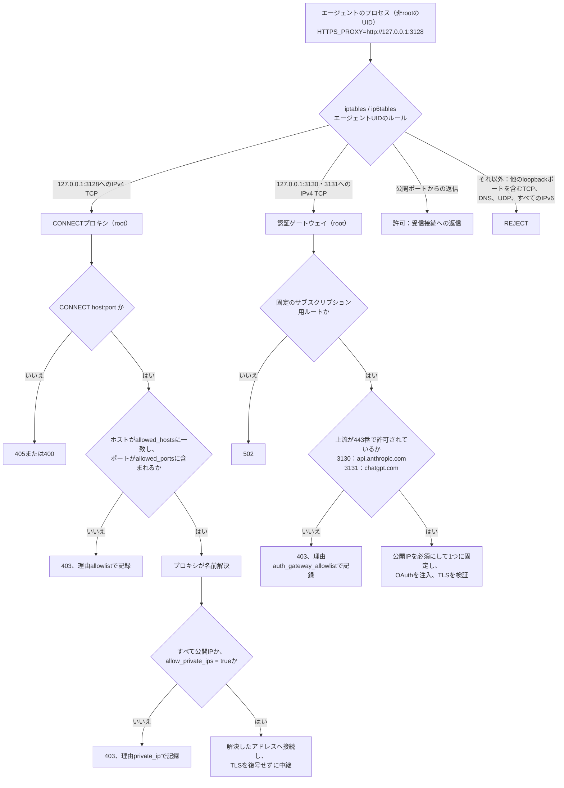
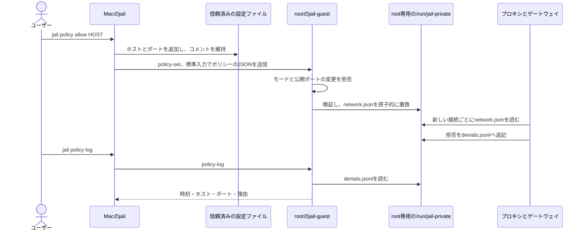

# 設定

[English](configuration.md) · 日本語 · [README](../README.ja.md)

設定は信頼できる入力として扱います。既定は`~/.config/jail/config.toml`です。`--config`、`JAIL_CONFIG`、既定ファイルの順に優先します。プロジェクト内の設定は**自動で読み込みません**。未知のキーや不正な値は拒否します。

全項目と初期値は[config.example.toml](../config.example.toml)を参照してください。相対指定のマウント元は設定ファイルのディレクトリから解決し、追加マウント先は`/extra/`配下に限定します。

たとえばホスト共有を読み取り専用にし、機密パスを隠し、外向きの接続先を限定する場合：

```toml
[resources]
cpus = 2
memory = "2G"

[workspace]
read_only = true
hidden = [".env", "secrets"]

[network]
mode = "allowlist"
allowed_hosts = ["api.anthropic.com", "claude.ai", "platform.claude.com",
                 "chatgpt.com", "auth.openai.com", "api.openai.com"]
allowed_ports = [443]
allow_private_ips = false
published_ports = []

[tools]
shell = false
edit = false
web_search = false
mcp = false
hooks = false
```

マウント・リソース・ポート・イメージの変更には`jail recreate`が必要です。通信の許可リストは起動中に反映できます。

## ワークスペースへの書き込み

ワークスペースは既定で書き込み可能です。次の3つの設定で範囲を狭められます（上ほど広く制限します）。

| 設定 | 効果 |
| --- | --- |
| `read_only = true`（または`tools.edit = false`） | ホスト共有をすべて読み取り専用にする |
| `allow_write = [...]` | 列挙したパスだけを書き込み可能にする |
| `protect_sensitive` / `deny_write = [...]` | 列挙したパスを読み取り専用にし、それ以外は書き込み可能のまま |

保護対象のパスは、`allow_write`で許可したパスの中でも常に読み取り専用です。ホストからの編集は可能で、隔離の対象外です。

### 機密パスの保護

既定で`.git/config`、`.git/hooks`、`.mcp.json`、プロジェクトの`.claude/`・`.codex/`、`.bashrc`・`.zshrc`・`.ripgreprc`を読み取り専用マウントで保護します。通常のソースは編集可能です。親ディレクトリもマウント境界にし、名前変更による保護対象の置換を防ぎます。保護パス内のsymlink・hard-linkと、ワークスペースに重なる書き込み可能な追加マウントは拒否します。

存在しない対象には**ホスト側から見えるプレースホルダー**（空ファイル／ディレクトリ、`.mcp.json`には`{}`）を作成します。既存内容は上書きせず、自動削除もしません。worktreeでは外部メタデータの代わりに`.git`ポインタを保護します。すべての実行設定を網羅するものではないため、プロジェクト固有の対象は追加してください。

```toml
[workspace]
protect_sensitive = true
deny_write = ["package.json", "scripts/trusted/"]
```

存在しないディレクトリには末尾`/`を付けます。`protect_sensitive = false`で既定の対象を無効化できますが、明示した`deny_write`は有効です。

### 書き込み可能なパスの指定

エージェントに特定のパスだけを書き込ませるには、`allow_write`に列挙します。ワークスペースのそれ以外は読み取り専用になります。

```toml
[workspace]
allow_write = ["src/", "tests/", "CHANGELOG.md"]
```

- パスはプロジェクトからの相対パスです。存在しないパスは、末尾に`/`があればディレクトリとして作成し、なければエラーにします。symlinkとhard linkのあるファイルは拒否します。
- 許可したパス内の保護対象は読み取り専用のままです。`hidden`に含まれるエントリは無視します。
- 許可したパスはそれぞれ独立したマウントです。名前変更・移動はできず、ワークスペースの他の場所との間でファイルを移動することもできません。
- ファイルを置き換えて保存するツールは単一ファイルの指定では失敗するため、ディレクトリでの指定を推奨します。Gitでコミットさせるには`.git/`も必要です。
- `read_only = true`・`tools.edit = false`とは併用できません。ワークスペースに重なる書き込み可能な追加マウントは拒否します。

## 通信ポリシー

`network.mode`は`open`（既定、外向き通信を制限しない）・`allowlist`・`none`（エージェントの通信をすべて遮断）のいずれかです。`allowlist`では`allowed_hosts`と`allowed_ports`で接続先を選びます。上の例のホスト一覧は出発点であり、すべてのアカウントや機能に必要な接続先を網羅しません。完全一致または`*.example.com`を使えます。ワイルドカードはサブドメインだけを許可し、`example.com`自体は含みません。

許可リストモードはHTTPSのCONNECTプロキシとエージェントUIDのファイアウォールを使い、直接TCP・直接DNS・直接IPv6を遮断します。通常のHTTPプロキシ要求、UDP、外向きの直接接続を必要とするツールには対応しません。上流のプライベートIP・loopback・link-localは既定で拒否します。許可した接続先へのデータ送信は可能で、リクエストの内容までは検査・制限しません。

### 許可リストの制御の仕組み

許可リストは、VM内の2つの層で強制します。ファイアウォールは、エージェントのプロセスが接続できるローカルの接続先を決めます。その先にあるrootのサービスが、接続できる上流のホストを決めます。ファイアウォールのルールはエージェントのUIDだけに適用します。そのため、rootのプロキシとゲートウェイは外部へ接続できますが、エージェントのプロセスはそれらを迂回できません。



- プロキシは、CONNECT行のホスト名とポートだけで判定します。名前解決はプロキシ自身が行い、解決したアドレスへ接続します。TLSはそのまま中継するため、パス・ヘッダー・本文は検査しません。
- ゲートウェイは`allow_private_ips`の設定にかかわらず、上流に公開IPを必須とします。
- `open`ではファイアウォールを設定しません。`none`では、プロキシとゲートウェイのポートを含め、エージェントの通信をすべて拒否します。

許可リストの変更は、再起動せずに実行中のコンテナへ反映します。



起動のたびに、信頼済みの設定ファイルの通信ポリシーもコンテナへ送ります。そのため、設定ファイルを手動で編集した変更は、次回の起動時か、`jail policy reload`の実行時に反映します。

### 許可リストの調整

`network.mode = "allowlist"`で通信拒否を確認し、必要な接続先を明示的に許可できます。

```sh
jail policy log
jail policy allow registry.npmjs.org
jail policy log --json
# allowed_hosts / allowed_ports / allow_private_ips を手動編集した後:
jail policy reload
```

`allow`は設定のコメントを維持し、起動中のコンテナへ再起動せず反映します。ホストとポートの一覧は独立しており、ポート追加は許可済みの全ホストに適用します。許可の削除は設定を編集してreloadしてください。通信モード・公開ポートの変更は再作成が必要です。変更は**新しい接続**に適用し、既存のCONNECT接続は切断しません。ログからの自動許可はしません。

root専用のログには時刻・ホスト名・ポート・拒否理由だけを残し、URL・ヘッダー・本文は保存しません。最大約2 MiBで、停止時に消えます。記録対象はプロキシ／認証ゲートウェイのポリシー拒否であり、直接通信のファイアウォール拒否・DNS失敗・操作履歴ではありません。`policy show`は設定ファイルの内容で、反映済みとは限りません。

## CLIのツール制限

`[tools]`でシェル・ファイル編集・Web検索・MCP・hooksなど、CLI本来の機能を切り替えます。MCPとhooksは既定で無効です。さらに`tools.claude_deny`（例：`["Bash(git push *)"]`）や`tools.codex_disabled_features`（例：`["multi_agent"]`）で制限を追加できます。設定したCLIバージョンが対応するルール・機能名を指定してください。
