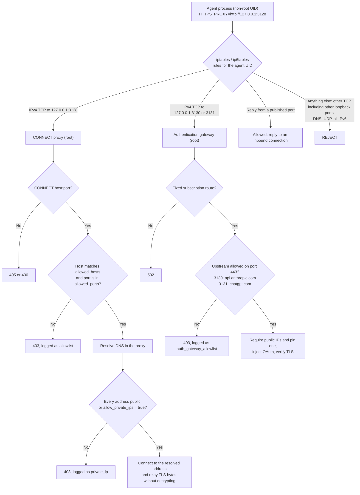
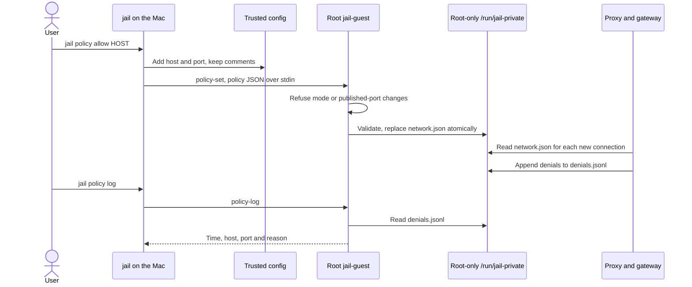

# Configuration

English · [日本語](configuration.ja.md) · [README](../README.md)

Configuration is trusted input. The default file is `~/.config/jail/config.toml`; `--config` takes precedence over `JAIL_CONFIG`, which takes precedence over that default. Project config files are **never loaded automatically**. Unknown keys and invalid values are rejected.

See [config.example.toml](../config.example.toml) for all settings and defaults. Relative mount sources resolve against the config file's directory; extra mount targets must be under `/extra/`.

For example, to make host mounts read-only, hide sensitive paths, and restrict outbound destinations:

```toml
[resources]
cpus = 2
memory = "2G"

[workspace]
read_only = true
hidden = [".env", "secrets"]

[network]
mode = "allowlist"
allowed_hosts = ["api.anthropic.com", "claude.ai", "platform.claude.com",
                 "chatgpt.com", "auth.openai.com", "api.openai.com"]
allowed_ports = [443]
allow_private_ips = false
published_ports = []

[tools]
shell = false
edit = false
web_search = false
mcp = false
hooks = false
```

Changes to mounts, resources, ports or the image require `jail recreate`; network allowlist changes can be applied live.

## Workspace writes

The workspace is writable by default. Three settings narrow that, from coarsest to finest:

| Setting | Effect |
| --- | --- |
| `read_only = true` (or `tools.edit = false`) | Every shared host mount is read-only |
| `allow_write = [...]` | Only the listed paths are writable |
| `protect_sensitive` / `deny_write = [...]` | The listed paths are read-only; the rest stays writable |

Protected paths always stay read-only, also inside `allow_write` paths. Host-side edits remain possible and are outside the agent isolation boundary.

### Protected paths

By default, `.git/config`, `.git/hooks`, `.mcp.json`, project `.claude/` and `.codex/`, `.bashrc`, `.zshrc`, and `.ripgreprc` are read-only mount boundaries. Ordinary source files remain writable. Parent mount boundaries prevent renaming a directory to replace a protected path. Symlink/hard-link aliases in protected paths and writable extra mounts overlapping the workspace are rejected.

Missing targets receive **host-visible placeholders** (empty files/directories; `{}` for `.mcp.json`). Existing contents are never overwritten. Placeholders are not automatically removed. A worktree's `.git` pointer is protected instead of inaccessible external metadata. This does not protect every possible executable configuration file; add project-specific paths explicitly:

```toml
[workspace]
protect_sensitive = true
deny_write = ["package.json", "scripts/trusted/"]
```

Use a trailing `/` for missing directories. Set `protect_sensitive = false` to disable defaults; explicit `deny_write` still applies.

### Writable paths

To let the agent write only specific paths, list them in `allow_write`. Everything else in the workspace becomes read-only:

```toml
[workspace]
allow_write = ["src/", "tests/", "CHANGELOG.md"]
```

- Paths are project-relative. A missing path with a trailing `/` is created as a directory; any other missing path is an error. Symlinks and hard-linked files are rejected.
- Protected paths inside an allowed path stay read-only, and an entry covered by `hidden` is skipped.
- Each allowed path is its own mount: it cannot be renamed or moved, and files cannot be moved between it and the rest of the workspace.
- Prefer directories: tools that save a file by replacing it fail on a single-file entry. Git commits need `.git/` in the list.
- It cannot be combined with `read_only = true` or `tools.edit = false`. Writable extra mounts overlapping the workspace are rejected.

## Network policy

`network.mode` is `open` (default, unrestricted outbound), `allowlist` or `none` (all agent traffic blocked). In allowlist mode, `allowed_hosts` and `allowed_ports` choose the reachable destinations. The host list in the example above is a starting point, not an exhaustive list for every account or feature. Exact hostnames and `*.example.com` are supported; the wildcard matches subdomains, not `example.com` itself.

Allowlist mode uses an HTTPS CONNECT proxy and an agent-UID firewall. It blocks direct TCP, direct DNS, and direct IPv6 traffic. Ordinary HTTP proxy requests, UDP, and tools requiring direct outbound connections are not supported. Private, loopback, and link-local upstream addresses are denied by default. Allowed destinations can still receive data; the allowlist does not inspect or restrict request contents.

### How allowlist enforcement works

Two layers inside the VM enforce the allowlist. The firewall decides which local endpoints agent processes can reach. Root-owned services behind those endpoints decide which upstream hosts are reachable. Firewall rules match only the agent's UID, so the root proxy and gateway can reach the network, while agent processes cannot bypass them.



- The proxy decides only from the host name and port in the CONNECT line. It resolves DNS itself and connects to the address it resolved. TLS is relayed unchanged, so paths, headers and bodies are not checked.
- The gateway always requires public upstream addresses, regardless of `allow_private_ips`.
- In `open` mode no firewall is installed. In `none` mode all agent traffic is rejected, including the proxy and gateway ports.

Policy changes reach a running container without restarting it:



Each launch also sends the trusted config's network policy to the container. Manual edits therefore apply on the next launch, or immediately with `jail policy reload`.

### Adjusting an allowlist

In `network.mode = "allowlist"`, inspect denials and approve a destination explicitly:

```sh
jail policy log
jail policy allow registry.npmjs.org
jail policy log --json
# After manually editing allowed_hosts/allowed_ports/allow_private_ips:
jail policy reload
```

`allow` preserves config comments and updates a running container without restarting it. Host and port lists are independent: adding a port permits it for all allowed hosts. Removing a host requires editing the trusted config and reloading. Network mode and published-port changes still require recreation. New policy applies to **new connections**; existing CONNECT tunnels are not terminated. No automatic approvals are made from logs.

The root-only journal contains time, hostname, port and reason—not URLs, headers or bodies. It is bounded to approximately 2 MiB and resets on stop. It records proxy/gateway policy denials, not direct firewall drops, DNS failures, or an operation audit trail. `policy show` shows configured, not necessarily already-applied, policy.

## CLI tool restrictions

The `[tools]` table switches native CLI features such as the shell, file edits, web search, MCP and hooks. MCP and hooks are disabled by default. Additional native restrictions can be configured with `tools.claude_deny` (for example, `["Bash(git push *)"]`) and `tools.codex_disabled_features` (for example, `["multi_agent"]`). Use rules and feature names supported by the configured CLI versions.
